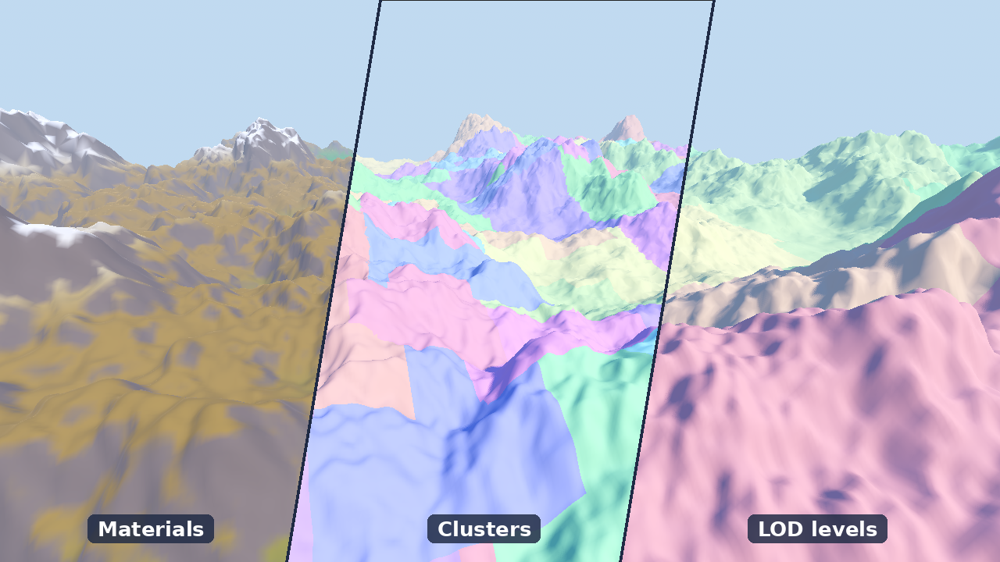

<h1> Godotite</h1>

**Nanite-style seamless level of detail for large static meshes in Godot 4.**

[](https://godotengine.org)
[](LICENSE)
[](addons/godotite/CHANGELOG.md)



Godotite builds a mesh into a hierarchy of small clusters, from full detail down to one coarse
root. Every frame, a `GodotiteLOD` node draws the coarsest clusters whose error stays under a pixel
threshold on screen: full detail close up, far fewer triangles in the distance, and never a crack
between them. A multi-million-triangle terrain or scan costs what its on-screen detail costs, not
what the whole mesh would.

It asks nothing of your content: no special materials or shaders, and a game using it needs no C#.

## Features

- **Two ways to build:** tick **Build Lod** when importing a `.glb`, `.gltf` or `.blend`, or add a
  `GodotiteBuilder` node to any mesh in a scene.
- **Everything carries over:** materials, UVs, normals, tangents, vertex colors and custom
  channels, with seams and color borders kept in place as the mesh simplifies.
- **One quality setting** for the whole project, changeable at runtime like a graphics option, with
  per-node overrides and an optional draw call budget.
- **Fast, deterministic builds** on every core; meshes over 4 million triangles build in cells, so
  memory follows the cell size, not the mesh.
- **Tools to trust the result:** a validator that checks a build is crack-free, an error measurement
  that picks a threshold from numbers, and debug views of clusters, levels and error.
- **Exports cleanly:** the DAG files a game uses are exported automatically, and the game runs
  without .NET.
- **A demo:** a generated terrain with a fly camera and a live overlay of what is drawn.

## How it works

```
 BUILD (once, C#)                                       RUNTIME (every frame, GDScript)

 mesh ─► weld ─► quadric error ─► leaf clusters         camera
                                       │                   │
                                       ▼                   ▼
                    repeat until one root:             choose the cut: coarsest clusters
                    group ─► merge ─► lock border ─►   under the pixel threshold
                    simplify to half ─► split          (incremental, usually free)
                                       │                   │
                                       ▼                   ▼
                              GodotiteDAG resource ──► one RenderingServer instance per
                                                       cluster, shown or hidden
```

Clusters are grouped a few at a time, merged, and simplified to half their triangles with their
shared outer border locked, so a coarse cluster always meets its neighbors exactly. Each cluster
stores its error, which never decreases toward the root, so the clusters the pixel rule chooses
cover the mesh exactly once: no gaps, no overlaps, no cracks.

The whole pipeline is written from scratch, with no third-party libraries: welding, quadric and
attribute error metrics, clustering, the simplifier, cell builds and compression, in about 6,000
lines of C#, and the runtime, tools and editor integration in about 5,000 lines of GDScript.
**[ALGORITHM.md](addons/godotite/ALGORITHM.md)** walks through each stage and why each rule
exists.

## Results

Measured on a generated world of 13.8 million triangles, built in the editor:

| | |
|---|---|
| Build | 88 s, 6,958 clusters in 13 levels |
| Drawn at the default 2 px threshold | 1.43M triangles, 10% of the mesh, before frustum culling |
| After frustum culling | 530k to 630k triangles in 70 to 97 draw calls |

The share drawn falls as meshes grow: 53% more source triangles drew about 24% more.

## Quick start

1. Copy `addons/godotite` into your project, or install it from the Asset Library.
2. Open the project in the **.NET version** of Godot 4.5 or later. If it has no C# yet:
   **Project › Tools › C# › Create C# solution**, then build once (the hammer, top right).
3. Enable **Project Settings › Plugins › Godotite**.
4. Try the demo: open `addons/godotite/demo/godotite_demo.tscn`, select **DemoTerrain**, press
   **Generate** in the Inspector, save and run. Fly with WASD and the mouse; Tab cycles the views.

To try this repository as it is, open its folder in the .NET editor and start from step 2.

## Documentation

| | |
|---|---|
| **[The guide](addons/godotite/README.md)** | Installing, the demo, building your meshes, quality, exporting (with and without .NET), checking and tuning, limits |
| **[ALGORITHM.md](addons/godotite/ALGORITHM.md)** | How it works: the build pipeline, the runtime cut, a glossary and a code map |
| **[CHANGELOG.md](addons/godotite/CHANGELOG.md)** | What changed in each version |

Every node and setting is also documented in the editor: **Help › Search Help › GodotiteBuilder**
or **GodotiteLOD**.

## Requirements and limits

- **Godot 4.5 or later**, tested on 4.5.1 and 4.7.2. Building needs the .NET version of Godot and
  the .NET SDK it asks for; running does not.
- Static meshes only. Godotite draws; collision is up to you.
- Below about 130,000 triangles a mesh is usually cheaper drawn as it is.
- Not in scope: virtual texturing, streaming, GPU-driven rendering.

## About

Godotite is developed by Matt Heinzen, tested against a generated game world of tens of millions of
triangles.

It is an LLM-assisted project: most of the code and documentation were written by Claude
(Anthropic), directed, tested and reviewed by the author.

Released under the [MIT license](LICENSE).
